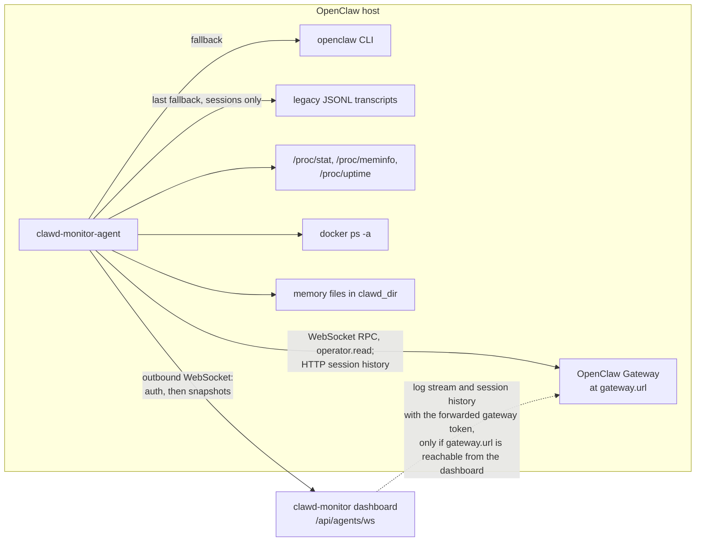

# clawd-monitor-agent

[](https://github.com/LanNguyenSi/clawd-monitor-agent/actions/workflows/ci.yml) [](https://www.npmjs.com/package/clawd-monitor-agent)

Push-based monitoring agent for [clawd-monitor](https://github.com/LanNguyenSi/clawd-monitor).

## Overview

Runs on each OpenClaw host, connects outbound to a central clawd-monitor
dashboard, and pushes live snapshots every 5 seconds; no inbound ports
required on the agent host. It collects session, cron, system-metrics,
memory-file, and Docker data and streams it over a single WebSocket
connection that reconnects with backoff if the dashboard is unreachable.

The diagram shows the local sources the agent reads, its single outbound
connection to the dashboard, and the calls the dashboard can make back to
the OpenClaw Gateway with the forwarded token (log stream, session
history).



## Key features

- Active OpenClaw sessions, read from the local OpenClaw Gateway when a Gateway token is set, with the `openclaw` CLI and legacy JSONL transcripts as fallbacks (see [OpenClaw data sources](docs/cli-reference.md#openclaw-data-sources))
- Scheduled cron jobs with next/last run times
- CPU and RAM metrics via `/proc`
- Memory files: `MEMORY.md`, `CURRENT.md`, today's and yesterday's daily log
- Docker containers (running and stopped): name, image, state, time since creation
- Last 5 messages per session, embedded in the snapshot (needs a Gateway token, except with legacy JSONL transcripts)
- Single outbound WebSocket, no inbound ports on the agent host

## Quick start

Requires Node.js 18+ (installer handles this on Debian/Ubuntu).

```bash
curl -fsSL https://raw.githubusercontent.com/LanNguyenSi/clawd-monitor-agent/master/install.sh \
  | sudo bash -s -- \
      --server wss://your-clawd-monitor-domain \
      --token <agent-token-from-settings>
```

Installs Node 18+ (via NodeSource if needed), the `clawd-monitor-agent`
npm package, a dedicated `clawd-agent` system user, a config at
`/etc/clawd-monitor-agent/config.json` (mode 0640), and a hardened systemd
unit. Re-running with the same args is an idempotent restart; re-running
with a different `--token` rotates the token. The token is never echoed to
stdout and is not embedded in the unit file. Full flag list: `bash
install.sh --help`.

The token is passed to the installer as an argument, so it is visible in
the process list while the installer runs, and your shell may keep the
command in its history. On a shared host, run it from a shell with history
disabled.

The installed service runs as `clawd-agent` with its home at
`/var/lib/clawd-agent` and `ProtectHome=true`. By default it reads memory
files from `/var/lib/clawd-agent/.openclaw/workspace`, and without a
Gateway token its sessions and cron jobs come from the `openclaw` CLI run
as `clawd-agent`. `--gateway-token` stores the token in the config file,
and the agent forwards that value to the dashboard. See [Adjusting the
installer's unit](docs/systemd-service.md#adjusting-the-installers-unit)
to set the Gateway token or the workspace path in a way that survives
re-running the installer.

Or install the package directly:

```bash
npm install -g clawd-monitor-agent
```

Get the token from the dashboard: click "+ Add Agent" in the top nav
(generates the token and a paste-ready install command), or go to
Settings -> Agent Tokens.

## Usage

```bash
clawd-monitor-agent \
  --server https://your-clawd-monitor-domain \
  --token <agent-token-from-settings> \
  --name "My OpenClaw Host" \
  --gateway http://localhost:18789
```

See [docs/cli-reference.md](docs/cli-reference.md) for every flag and the
JSON config-file format.

## Documentation

- [docs/cli-reference.md](docs/cli-reference.md): full CLI flag reference and the JSON config-file format
- [docs/protocol.md](docs/protocol.md): the agent/server WebSocket protocol and lifecycle diagram
- [docs/systemd-service.md](docs/systemd-service.md): running the agent as a systemd service without the installer
- [docs/development.md](docs/development.md): testing notes (points to CONTRIBUTING.md for setup)
- [CHANGELOG.md](./CHANGELOG.md): per-release notes

## Development and contributing

See [CONTRIBUTING.md](./CONTRIBUTING.md) for setup, running locally, adding
a collector, and pull request conventions.

## License

MIT, see [LICENSE](./LICENSE). Pre-1.0: the WebSocket protocol and config
shape are not yet stable and may change between minor versions.

---

*Part of the [clawd-monitor](https://github.com/LanNguyenSi/clawd-monitor) ecosystem*
