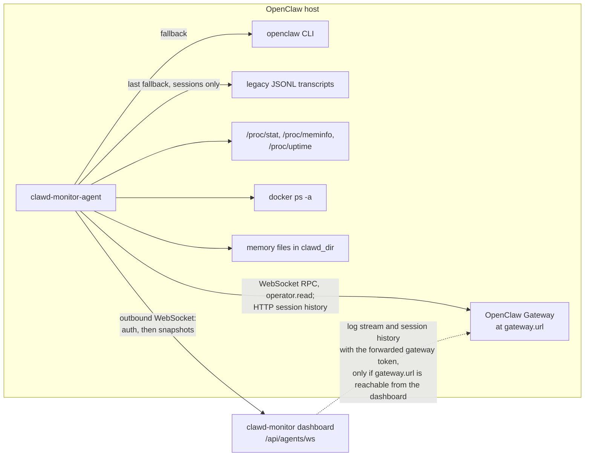

# clawd-monitor-agent

[](https://github.com/LanNguyenSi/clawd-monitor-agent/actions/workflows/ci.yml) [](https://www.npmjs.com/package/clawd-monitor-agent)

Push-based monitoring agent for [clawd-monitor](https://github.com/LanNguyenSi/clawd-monitor).

## Overview

Runs on each OpenClaw host, connects outbound to a central clawd-monitor
dashboard, and pushes live snapshots every 5 seconds; no inbound ports
required on the agent host. It collects session, cron, system-metrics,
memory-file, and Docker data and streams it over a single WebSocket
connection that reconnects with backoff if the dashboard is unreachable.

The diagram shows the local sources the agent reads, its single outbound
connection to the dashboard, and the calls the dashboard can make back to
the OpenClaw Gateway with the forwarded token (log stream, session
history).



## Key features

- Active OpenClaw sessions, read from the local OpenClaw Gateway when a Gateway token is set, with the `openclaw` CLI and legacy JSONL transcripts as fallbacks (see [OpenClaw data sources](docs/cli-reference.md#openclaw-data-sources))
- Scheduled cron jobs with next/last run times
- CPU and RAM metrics via `/proc`
- Memory files: `MEMORY.md`, `CURRENT.md`, today's and yesterday's daily log
- Docker containers (running and stopped): name, image, state, time since creation
- Last 5 messages per session, embedded in the snapshot (needs a Gateway token, except with legacy JSONL transcripts)
- Single outbound WebSocket, no inbound ports on the agent host

## Quick start

Requires Node.js 18+ (installer handles this on Debian/Ubuntu).

```bash
printf 'Agent token: '; read -rs CLAWD_AGENT_TOKEN; echo; export CLAWD_AGENT_TOKEN
curl -fsSL https://raw.githubusercontent.com/LanNguyenSi/clawd-monitor-agent/master/install.sh \
  | sudo --preserve-env=CLAWD_AGENT_TOKEN bash -s -- \
      --server wss://your-clawd-monitor-domain
unset CLAWD_AGENT_TOKEN
```

Paste the token from Settings -> Agent Tokens at the prompt. If `sudo`
answers "not allowed to set the following environment variables" (a
restricted sudoers), run the `curl ... | bash -s -- ...` line from a root
shell without `sudo`, or use `--token-file <path>`. Installs Node
18+ (via NodeSource if needed), the `clawd-monitor-agent` npm package, a
dedicated `clawd-agent` system user, a config at
`/etc/clawd-monitor-agent/config.json` (mode 0640), the token in its own
file `/etc/clawd-monitor-agent/token` (mode 0600, owned by `clawd-agent`),
and a hardened systemd unit that starts the agent with `--token-file`.
Re-running with the same args is an idempotent restart; re-running with a
different token rotates it. The token is never echoed to stdout and is not
embedded in the unit file. Full flag list: `bash install.sh --help`.

The installer takes the token from the first of these that is set:
`--token-file <path>`, the `CLAWD_AGENT_TOKEN` environment variable,
`--token <value>`. The `--token` flag still works but is deprecated: its
value is visible in the process list (`ps`, `/proc/<pid>/cmdline`) for as
long as the installer runs, and the installer prints a warning. The
environment variable is not part of any command line; it is readable only
by root and the installing user (`/proc/<pid>/environ`), the installer
unsets it before it starts npm or apt, and the prompt above keeps it out of
the shell history too. The dashboard's "+ Add Agent" snippet sets the
variable inline (`CLAWD_AGENT_TOKEN='...' sudo ...`), which keeps the token
out of `ps` but leaves it in your shell history; use the prompt above, or
start the command with a space if your shell has `HISTCONTROL=ignorespace`.

The installed service runs as `clawd-agent` with its home at
`/var/lib/clawd-agent` and `ProtectHome=true`. By default it reads memory
files from `/var/lib/clawd-agent/.openclaw/workspace`, and without a
Gateway token its sessions and cron jobs come from the `openclaw` CLI run
as `clawd-agent`. `--gateway-token-file <path>` makes the installer copy
the token to `/etc/clawd-monitor-agent/gateway-token` (mode 0600, owned by
`clawd-agent`) and start the agent with `--gateway-token-file`; the agent
forwards that token to the dashboard. `--gateway-token <value>` does the same
but is deprecated: the value is visible in `ps` while the installer runs. See
[Adjusting the installer's unit](docs/systemd-service.md#adjusting-the-installers-unit)
to keep the Gateway token on the host (`OPENCLAW_GATEWAY_TOKEN`) or to set
the workspace path in a way that survives re-running the installer.

The agent takes the Gateway token from the first of these that is set:
`--gateway-token-file`, the `OPENCLAW_GATEWAY_TOKEN` environment variable,
`--gateway-token` (deprecated, visible in `ps`), `gateway.token` in the
config file. Only the environment variable is never forwarded to the
dashboard. See [Gateway token](docs/cli-reference.md#gateway-token) for the
details and the upgrade note for hosts installed with `--gateway-token`: they
keep working unchanged, and re-running the installer with
`--gateway-token-file` moves the token out of `config.json`.

Or install the package directly:

```bash
npm install -g clawd-monitor-agent
```

Get the token from the dashboard: click "+ Add Agent" in the top nav
(generates the token and a paste-ready install command), or go to
Settings -> Agent Tokens.

## Usage

```bash
install -m 600 /dev/null ~/.clawd-agent-token     # then put the token in it
clawd-monitor-agent \
  --server https://your-clawd-monitor-domain \
  --token-file ~/.clawd-agent-token \
  --name "My OpenClaw Host" \
  --gateway http://localhost:18789
```

The agent reads the token from the first of these that is set:
`--token-file <path>` (mode 0600; it refuses a file other users can read
and warns about group access), the `CLAWD_AGENT_TOKEN` environment
variable, `--token <value>`, the `token` key of a `--config` file. Do not
pass the token with `--token`: the value stays in the process list for as
long as the agent runs, so any local user can read it with `ps` and use it
to connect as your agent. The flag still works for existing installs and
prints a deprecation warning on stderr.

See [docs/cli-reference.md](docs/cli-reference.md) for every flag and the
JSON config-file format.

### Upgrading an install that uses `--token`

Hosts set up with `install.sh` before this change keep working as they are:
their unit never carried the token, it reads it from `config.json`. Re-run
the installer to move the token into its own file (it restarts the service
once). A host that runs the agent with `--token <value>` in its own unit or
start script, the form this README used to show, moves like this, without
changing the token and with only the restart's reconnect as downtime:

1. `npm install -g clawd-monitor-agent@latest` (the running agent is not
   affected).
2. Create the file and put the token in it. The owner is the user in the
   unit's `User=` (`clawd-agent` for an installer-made unit), and the
   directory must exist first, or pick a path that user owns:
   `sudo install -d -m 0750 -o root -g clawd-agent /etc/clawd-monitor-agent`
   (skip it if the installer made the directory), then
   `sudo install -m 600 -o clawd-agent /dev/null /etc/clawd-monitor-agent/token`
   and write the token into it (for example with `sudoedit`).
3. In the unit, replace `--token <value>` with `--token-file
   /etc/clawd-monitor-agent/token` (use `systemctl edit` for a drop-in).
4. `sudo systemctl daemon-reload && sudo systemctl restart clawd-monitor-agent`.

The old value was readable in the process list while it ran. If other
users share the host, rotate it: create a new token in the dashboard, put
it in the file, restart, then revoke the old one in Settings.

## Documentation

- [docs/cli-reference.md](docs/cli-reference.md): full CLI flag reference and the JSON config-file format
- [docs/protocol.md](docs/protocol.md): the agent/server WebSocket protocol and lifecycle diagram
- [docs/systemd-service.md](docs/systemd-service.md): running the agent as a systemd service without the installer
- [docs/development.md](docs/development.md): testing notes (points to CONTRIBUTING.md for setup)
- [CHANGELOG.md](./CHANGELOG.md): per-release notes

## Development and contributing

See [CONTRIBUTING.md](./CONTRIBUTING.md) for setup, running locally, adding
a collector, and pull request conventions.

## License

MIT, see [LICENSE](./LICENSE). Pre-1.0: the WebSocket protocol and config
shape are not yet stable and may change between minor versions.

---

*Part of the [clawd-monitor](https://github.com/LanNguyenSi/clawd-monitor) ecosystem*
