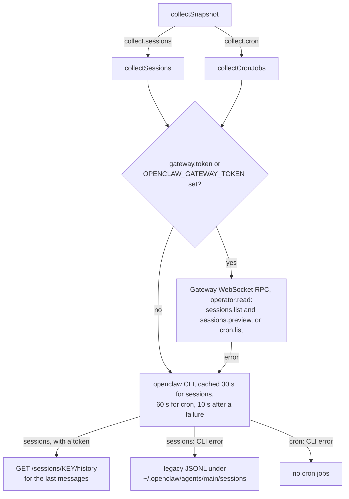

# CLI reference

## OpenClaw data sources

Sessions and cron jobs are collected in this order:

1. **Gateway WebSocket RPC** when a Gateway token is available (`--gateway-token`, `gateway.token`, or the `OPENCLAW_GATEWAY_TOKEN` environment variable). The agent logs in with the operator `read` scope and calls `sessions.list`, `sessions.preview` and `cron.list`. This takes tens of milliseconds.
2. **`openclaw` CLI** (`sessions --all-agents --json --limit 20`, `cron list --all --json`), cached for 30 s and 60 s; a failed call is retried after 10 s. Each call cold-starts Node (about 3 s of CPU).
3. **Legacy JSONL transcripts** under `~/.openclaw/agents/main/sessions/` (OpenClaw before 2026.9).

Item 3 applies to sessions only: if the CLI fails, cron jobs are reported as an empty list.

The flowchart shows this fallback chain for each collector and where the Gateway token comes from.



With systemd, put the token in an environment file (mode 0600) and reference it from the unit:

```ini
[Service]
EnvironmentFile=/etc/clawd-monitor-agent/openclaw.env   # OPENCLAW_GATEWAY_TOKEN=...
```

If you installed with `install.sh`, do not edit its unit file: the
installer rewrites `/etc/systemd/system/clawd-monitor-agent.service` on
every run. Add the line through a drop-in instead (`systemctl edit
clawd-monitor-agent`), which the installer leaves alone. See [Adjusting
the installer's unit](systemd-service.md#adjusting-the-installers-unit).

The agent always sends `gateway.url` to the dashboard in the `auth`
message. It also sends `gateway.token` when that is set with
`--gateway-token` or in the config file; `OPENCLAW_GATEWAY_TOKEN` stays on
the agent host. The dashboard's snapshot views, including the session
messages, do not need either value. The dashboard uses them only when it
calls that URL from its own host, for example to stream OpenClaw logs, so
with the default `http://localhost:18789` those calls go to the dashboard
host, not to the agent host.

## Options

| Flag | Default | Description |
|------|---------|-------------|
| `--server` | none | clawd-monitor URL (required). The agent strips trailing slashes and appends `/api/agents/ws`. |
| `--token` | none | Agent token from Settings (required) |
| `--name` | OS hostname, or `unknown` | Display name in dashboard (uses `os.hostname()`; falls back to the literal string `unknown` if that call throws) |
| `--gateway` | `http://localhost:18789` | OpenClaw gateway URL |
| `--gateway-token` | none | OpenClaw gateway auth token. Enables the Gateway WebSocket collectors for sessions and cron. This value is also sent to the dashboard server in the `auth` message; prefer the `OPENCLAW_GATEWAY_TOKEN` environment variable, which is not forwarded |
| `--clawd-dir` | `~/.openclaw/workspace` | Path to OpenClaw workspace (memory files only, see note) |
| `--interval` | `5000` | Snapshot push interval (ms). Numeric values below 1000 are raised to 1000, whether set via `--interval` or `intervalMs` in a `--config` file. A non-numeric value (for example `abc` or `5s`) or a value above 2147483647 (the largest timer delay, beyond which the interval would fire every millisecond) is rejected: the agent prints an error and exits with code 1. |
| `--config` | none | Path to JSON config file |
| `--no-memory` | off | Disable memory-file collection (collected by default) |
| `--no-docker` | off | Disable Docker collection (collected by default) |
| `--debug` | off | Enable debug logging |
| `--version` | none | Print version and exit |
| `--help`, `-h` | none | Show usage and exit |

`--clawd-dir` only governs where memory files (`MEMORY.md`, `CURRENT.md`, daily logs) are read from. Sessions and cron jobs do not use it: they come from the sources listed under [OpenClaw data sources](#openclaw-data-sources), and the legacy JSONL fallback always reads `~/.openclaw/agents/main/sessions/` in the home directory of the user the agent runs as.

## Config file

A `--config` JSON file can set the following keys, each read by `loadConfig`
(`src/config.ts`). A matching command-line flag, when given, overrides the
same key from the file.

| Flag | Config key |
|------|------------|
| `--server` | `server` |
| `--token` | `token` |
| `--name` | `name` |
| `--gateway` | `gateway.url` |
| `--gateway-token` | `gateway.token` |
| `--clawd-dir` | `clawd_dir` |
| `--interval` | `intervalMs` |
| `--no-memory` | `collect.memory` (set `false` in the file to disable) |
| `--no-docker` | `collect.docker` (set `false` in the file to disable) |
| `--debug` | `logLevel` (the flag only ever sets `"debug"`; the file accepts `debug`, `info` (default), `warn`, or `error`; any other value, including a different letter case, silently suppresses all leveled `[clawd-agent][...]` log lines; the startup banner still prints) |

`--version` and `--help`/`-h` have no config-file equivalent: they only
exit immediately after printing.

The file can also set keys with no command-line flag at all: `agentId`
(persisted agent identity; auto-generated and cached at
`~/.clawd-agent-id` if omitted) and `collect.sessions`, `collect.cron`,
`collect.metrics` (all default to `true`, no CLI toggle exists for them).

```json
{
  "server": "https://your-clawd-monitor-domain",
  "token": "<agent-token>",
  "name": "My OpenClaw Host",
  "gateway": {
    "url": "http://localhost:18789"
  },
  "collect": {
    "sessions": true,
    "cron": true,
    "metrics": true,
    "memory": true,
    "docker": true
  },
  "intervalMs": 5000
}
```

`loadConfig` ignores any key in the file it does not recognize; a typo in
a key name is silently dropped rather than reported.

If you installed with `install.sh`, note that re-running it rewrites
`/etc/clawd-monitor-agent/config.json` from scratch (its `write_config`
step), so any key you hand-added to that file is lost on the next
install/upgrade run. A systemd drop-in can set the Gateway token and the
workspace path in a way that survives those runs; see [Adjusting the
installer's unit](systemd-service.md#adjusting-the-installers-unit).

## Installer flags

`install.sh --help` prints the installer's own option list. It accepts `--server`, `--token`, `--name`, `--gateway`, `--gateway-token`, `--interval`, and `-h`/`--help`; it has no config-file or collector-toggle flags of its own (those are agent runtime options, set later via the CLI or the config file it writes at `/etc/clawd-monitor-agent/config.json`).
