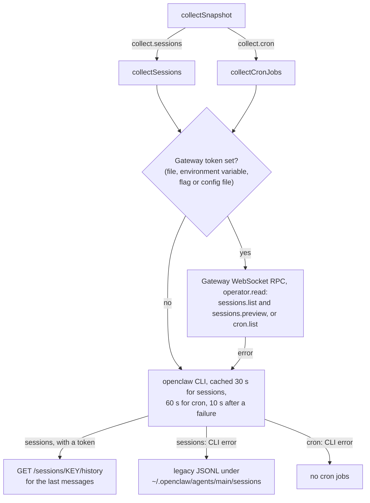

# CLI reference

## OpenClaw data sources

Sessions and cron jobs are collected in this order:

1. **Gateway WebSocket RPC** when a Gateway token is available (`--gateway-token-file`, the `OPENCLAW_GATEWAY_TOKEN` environment variable, `--gateway-token`, or `gateway.token`; see [Gateway token](#gateway-token)). The agent logs in with the operator `read` scope and calls `sessions.list`, `sessions.preview` and `cron.list`. This takes tens of milliseconds.
2. **`openclaw` CLI** (`sessions --all-agents --json --limit 20`, `cron list --all --json`), cached for 30 s and 60 s; a failed call is retried after 10 s. Each call cold-starts Node (about 3 s of CPU).
3. **Legacy JSONL transcripts** under `~/.openclaw/agents/main/sessions/` (OpenClaw before 2026.9).

Item 3 applies to sessions only: if the CLI fails, cron jobs are reported as an empty list.

The flowchart shows this fallback chain for each collector and where the Gateway token comes from.



With systemd, put the token in a file (mode 0600) and reference it from the unit, or put it in an environment file (mode 0600):

```ini
[Service]
ExecStart=/usr/bin/clawd-monitor-agent --config /etc/clawd-monitor-agent/config.json --token-file /etc/clawd-monitor-agent/token --gateway-token-file /etc/clawd-monitor-agent/gateway-token
# or, instead of the file: the token stays on the host and is not forwarded
EnvironmentFile=/etc/clawd-monitor-agent/openclaw.env   # OPENCLAW_GATEWAY_TOKEN=...
```

If you installed with `install.sh`, do not edit its unit file: the
installer rewrites `/etc/systemd/system/clawd-monitor-agent.service` on
every run. Add the line through a drop-in instead (`systemctl edit
clawd-monitor-agent`), which the installer leaves alone. See [Adjusting
the installer's unit](systemd-service.md#adjusting-the-installers-unit).

The agent always sends `gateway.url` to the dashboard in the `auth`
message. It also sends the Gateway token when that is set with
`--gateway-token-file`, `--gateway-token` or in the config file;
`OPENCLAW_GATEWAY_TOKEN` stays on the agent host (see [Gateway
token](#gateway-token)). The dashboard's snapshot views, including the session
messages, do not need either value. The dashboard uses them only when it
calls that URL from its own host, for example to stream OpenClaw logs, so
with the default `http://localhost:18789` those calls go to the dashboard
host, not to the agent host.

## Options

| Flag | Default | Description |
|------|---------|-------------|
| `--server` | none | clawd-monitor URL (required). The agent strips trailing slashes and appends `/api/agents/ws`. |
| `--token-file` | none | File holding the agent token (see [Agent token](#agent-token)). Recommended |
| `--token` | none | Agent token from Settings. Deprecated: the value is visible in the process list; the agent prints a warning on stderr |
| `--name` | OS hostname, or `unknown` | Display name in dashboard (uses `os.hostname()`; falls back to the literal string `unknown` if that call throws) |
| `--gateway` | `http://localhost:18789` | OpenClaw gateway URL |
| `--gateway-token-file` | none | File holding the OpenClaw gateway auth token (see [Gateway token](#gateway-token)). Recommended. Enables the Gateway WebSocket collectors for sessions and cron. The token is also sent to the dashboard server in the `auth` message; use the `OPENCLAW_GATEWAY_TOKEN` environment variable to keep it on the host |
| `--gateway-token` | none | OpenClaw gateway auth token. Deprecated: the value is visible in the process list; the agent prints a warning on stderr. Otherwise as `--gateway-token-file` |
| `--clawd-dir` | `~/.openclaw/workspace` | Path to OpenClaw workspace (memory files only, see note) |
| `--interval` | `5000` | Snapshot push interval (ms). Numeric values below 1000 are raised to 1000, whether set via `--interval` or `intervalMs` in a `--config` file. A non-numeric value (for example `abc` or `5s`) or a value above 2147483647 (the largest timer delay, beyond which the interval would fire every millisecond) is rejected: the agent prints an error and exits with code 1. |
| `--config` | none | Path to JSON config file |
| `--no-memory` | off | Disable memory-file collection (collected by default) |
| `--no-docker` | off | Disable Docker collection (collected by default) |
| `--debug` | off | Enable debug logging |
| `--version` | none | Print version and exit |
| `--help`, `-h` | none | Show usage and exit |

`--token-file` and `--gateway-token-file` require a value: when the flag is the last argument, the next argument starts with `--`, or the value is an empty string, the agent prints an error naming the flag to stderr and exits with code 1 instead of dropping the flag and falling through to another token source.

`--clawd-dir` only governs where memory files (`MEMORY.md`, `CURRENT.md`, daily logs) are read from. Sessions and cron jobs do not use it: they come from the sources listed under [OpenClaw data sources](#openclaw-data-sources), and the legacy JSONL fallback always reads `~/.openclaw/agents/main/sessions/` in the home directory of the user the agent runs as.

## Agent token

The agent needs a token from Settings. It takes it from the first of these
that is set (the token is required; the agent exits with code 1 if none is):

1. `--token-file <path>`: the file's content with surrounding whitespace removed. The
   agent checks the mode of the opened file: any access for "other" users
   (for example 0644) is refused with exit code 1 and a `chmod 600` hint, access
   for the group only (for example 0640) is accepted with a warning. An
   unreadable, non-regular or empty file is an error; the agent does not
   fall through to the sources below.
2. The `CLAWD_AGENT_TOKEN` environment variable. An empty or blank value
   counts as unset. The agent removes the variable from its own environment
   after reading it, so the `docker` and `openclaw` processes it starts do
   not inherit it.
3. `--token <value>`, deprecated. The value is visible in `ps` and in
   `/proc/<pid>/cmdline` for as long as the agent runs. An empty value
   counts as unset. The warning is printed whenever the flag is given, even
   when a higher source wins.
4. `token` in the `--config` file.

`install.sh` writes the token to `/etc/clawd-monitor-agent/token` (mode
0600, owned by the service user) and starts the agent with `--token-file`.

## Gateway token

The OpenClaw Gateway token is optional. It enables the Gateway WebSocket
collectors and the session history requests. The collectors use the first of
these that is set, the same order as for the agent token:

1. `--gateway-token-file <path>`: the file's content with surrounding
   whitespace removed. The mode check is the one of the agent token file (any
   access for "other" users is refused with exit code 1 and a `chmod 600`
   hint, group-only access is accepted with a warning; an unreadable,
   non-regular or empty file is an error and the agent does not fall through
   to the sources below).
2. The `OPENCLAW_GATEWAY_TOKEN` environment variable. An empty or blank value
   counts as unset.
3. `--gateway-token <value>`, deprecated. The value is visible in `ps` and in
   `/proc/<pid>/cmdline` for as long as the agent runs. An empty value counts
   as unset. The warning is printed whenever the flag is given, even when a
   higher source wins.
4. `gateway.token` in the `--config` file.

Which value goes to the dashboard server in the `auth` message is decided
separately and by what was true before the file existed: the token from
`--gateway-token-file`, else `--gateway-token`, else `gateway.token` is sent
(in that order); the environment variable is never sent, so with only the
variable set nothing is forwarded.

| Set | Used by the collectors | Sent to the dashboard |
|-----|------------------------|-----------------------|
| file only | file | file |
| `OPENCLAW_GATEWAY_TOKEN` only | variable | nothing |
| `--gateway-token` only | flag | flag |
| `gateway.token` only | config | config |
| variable and `--gateway-token` | variable | flag |
| variable and `gateway.token` | variable | config |
| file and any other | file | file |
| nothing | none (CLI fallback) | nothing |

The agent does not remove `OPENCLAW_GATEWAY_TOKEN` from its own environment,
unlike `CLAWD_AGENT_TOKEN`: the `openclaw` CLI that the sessions and cron
collectors run as a fallback reads that variable itself. The agent's own
Gateway calls use the resolved value above and no longer read the variable
directly. A token from the file, the flag or the config file is not passed to
the `openclaw` CLI.

`install.sh` writes the token to `/etc/clawd-monitor-agent/gateway-token`
(mode 0600, owned by the service user) and starts the agent with
`--gateway-token-file`; `config.json` no longer holds it.

### Upgrading an install that used `--gateway-token`

Hosts installed with a release that took `--gateway-token` keep the token in
`gateway.token` of `/etc/clawd-monitor-agent/config.json`. That keeps working
unchanged. To move it out of the config file, re-run the installer with the
token in a file (`--gateway-token-file <path>`); it writes
`/etc/clawd-monitor-agent/gateway-token`, adds `--gateway-token-file` to the
unit and drops `gateway.token` from `config.json`. A re-run without a gateway
token removes that file, like the rest of the installer's files. If you set
the token in a systemd drop-in, point `--gateway-token-file` at your own file
there instead. The token is forwarded to the dashboard exactly as before; to
keep it on the host, use `OPENCLAW_GATEWAY_TOKEN` in an `EnvironmentFile=`.

If both the variable and `gateway.token` or `--gateway-token` are set to
different values, the collectors now use the variable (they used the flag or
config value before); the value sent to the dashboard is unchanged.

## Config file

A `--config` JSON file can set the following keys, each read by `loadConfig`
(`src/config.ts`). A matching command-line flag, when given, overrides the
same key from the file.

| Flag | Config key |
|------|------------|
| `--server` | `server` |
| `--token` | `token` |
| `--name` | `name` |
| `--gateway` | `gateway.url` |
| `--gateway-token` | `gateway.token` |
| `--gateway-token-file` | none (a file path has no config-file key) |
| `--clawd-dir` | `clawd_dir` |
| `--interval` | `intervalMs` |
| `--no-memory` | `collect.memory` (set `false` in the file to disable) |
| `--no-docker` | `collect.docker` (set `false` in the file to disable) |
| `--debug` | `logLevel` (the flag only ever sets `"debug"`; the file accepts `debug`, `info` (default), `warn`, or `error`; any other value, including a different letter case, silently suppresses all leveled `[clawd-agent][...]` log lines; the startup banner still prints) |

`--version` and `--help`/`-h` have no config-file equivalent: they only
exit immediately after printing.

The file can also set keys with no command-line flag at all: `agentId`
(persisted agent identity; auto-generated and cached at
`~/.clawd-agent-id` if omitted) and `collect.sessions`, `collect.cron`,
`collect.metrics` (all default to `true`, no CLI toggle exists for them).

```json
{
  "server": "https://your-clawd-monitor-domain",
  "token": "<agent-token>",
  "name": "My OpenClaw Host",
  "gateway": {
    "url": "http://localhost:18789"
  },
  "collect": {
    "sessions": true,
    "cron": true,
    "metrics": true,
    "memory": true,
    "docker": true
  },
  "intervalMs": 5000
}
```

`loadConfig` ignores any key in the file it does not recognize; a typo in
a key name is silently dropped rather than reported.

If you installed with `install.sh`, note that re-running it rewrites
`/etc/clawd-monitor-agent/config.json` from scratch (its `write_config`
step), so any key you hand-added to that file is lost on the next
install/upgrade run. A systemd drop-in can set the Gateway token and the
workspace path in a way that survives those runs; see [Adjusting the
installer's unit](systemd-service.md#adjusting-the-installers-unit).

## Installer flags

`install.sh --help` prints the installer's own option list. It accepts `--server`, `--token-file`, `--token` (deprecated), `--name`, `--gateway`, `--gateway-token-file`, `--gateway-token` (deprecated), `--interval`, and `-h`/`--help`; it has no config-file or collector-toggle flags of its own (those are agent runtime options, set later via the CLI or the config file it writes at `/etc/clawd-monitor-agent/config.json`). The installer takes the token from `--token-file`, the `CLAWD_AGENT_TOKEN` environment variable or `--token`, in that order (use `sudo --preserve-env=CLAWD_AGENT_TOKEN` to hand the variable through `sudo`); see [Agent token](#agent-token). If the installed agent predates `--token-file`, the installer keeps the token in `config.json` as before. The gateway token comes from `--gateway-token-file`, else `--gateway-token`; the installer reads no environment variable for it, because `OPENCLAW_GATEWAY_TOKEN` is often set on an OpenClaw host and would then be forwarded to the dashboard by accident. If the installed agent predates `--gateway-token-file`, the gateway token stays in `config.json` as before; see [Gateway token](#gateway-token).
